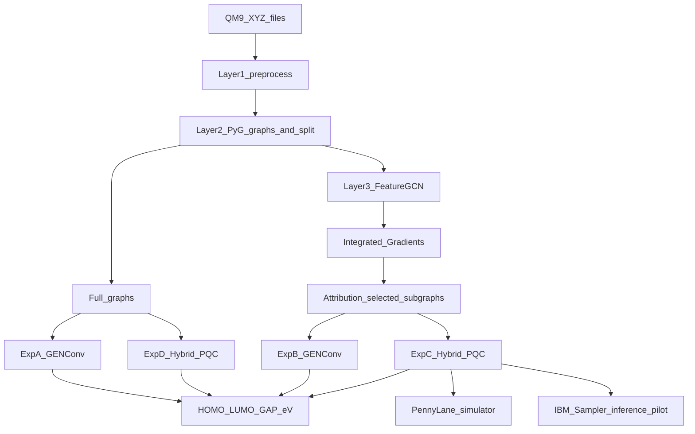

# QCGNN: Hybrid Quantum–Classical Graph Pipeline for QM9 Orbital Energies

Attribution-guided molecular subgraph selection with classical GENConv baselines and a compact hybrid quantum–classical regressor for **HOMO**, **LUMO**, and **HOMO–LUMO gap** on QM9.

> **Scientific disclaimer.** In this repository, “causal” in older filenames and UI labels means **gradient-based attribution**, not proven physical causality. Main training metrics come from **PennyLane local simulation**. A small number of **IBM Quantum** jobs exist as **inference pilots**, not a full test-set hardware evaluation. This project **does not claim quantum advantage**.

For a detailed readiness audit and publication plan, see [`docs/research_readiness_and_publication_roadmap.md`](docs/research_readiness_and_publication_roadmap.md).

---

## Table of contents

1. [Abstract and motivation](#1-abstract-and-motivation)
2. [Research problem and objectives](#2-research-problem-and-objectives)
3. [Proposed architecture](#3-proposed-architecture)
4. [System architecture diagram](#4-system-architecture-diagram)
5. [Layer-wise pipeline](#5-layer-wise-pipeline)
6. [Mathematical formulation](#6-mathematical-formulation)
7. [Quantum circuit and workflow](#7-quantum-circuit-and-workflow)
8. [QM9 dataset and targets](#8-qm9-dataset-and-targets)
9. [Technology stack](#9-technology-stack)
10. [Repository structure](#10-repository-structure)
11. [Installation](#11-installation)
12. [Dataset preparation](#12-dataset-preparation)
13. [Training](#13-training)
14. [Evaluation](#14-evaluation)
15. [IBM Quantum hardware](#15-ibm-quantum-hardware)
16. [Experimental results](#16-experimental-results)
17. [Visualizations](#17-visualizations)
18. [Demo application](#18-demo-application)
19. [Limitations](#19-limitations)
20. [Reproducibility](#20-reproducibility)
21. [Future work](#21-future-work)
22. [Contributions and novelty](#22-contributions-and-novelty)
23. [Citation](#23-citation)
24. [Acknowledgements](#24-acknowledgements)

---

## 1. Abstract and motivation

Predicting electronic orbital energies from molecular graphs is a standard task on the **QM9** benchmark. Classical graph neural networks (GNNs) are already strong on full graphs. This project asks a narrower, practical question:

> If we retain only an **attribution-selected induced subgraph** of each molecule, how do a classical GENConv model and a **compact hybrid quantum–classical head** compare in accuracy and sensitivity to that pruning?

The implemented hybrid model pools atom features, maps them to **8 angle encodings**, runs a small PennyLane parameterized circuit, and reads out HOMO / LUMO / gap. Classical GENConv baselines use the same targets and splits for a **2×2 comparison**: full vs reduced graphs × classical vs hybrid.

---

## 2. Research problem and objectives

| Objective | Status in this repo |
|-----------|---------------------|
| Build QM9 molecular graphs with fixed node/edge features | Implemented |
| Train-only target normalization; evaluate in eV | Implemented |
| Select subgraphs via Integrated Gradients (training path) | Implemented (`layer3_causal.py`) |
| Compare full-graph vs reduced-graph GENConv | Implemented (Experiments A, B) |
| Train/evaluate pooled hybrid quantum–classical model | Implemented (Experiments C, D) |
| Local PennyLane simulation metrics | Executed (saved JSON under `results/`) |
| IBM QPU inference for selected molecules | Implemented; **pilot jobs only** |
| Multi-seed statistics / ablations / quantum advantage | **Not completed** |

**Prediction targets**

| Target | Meaning | Units in evaluation |
|--------|---------|---------------------|
| HOMO | Highest occupied molecular orbital energy | eV (after Hartree → eV) |
| LUMO | Lowest unoccupied molecular orbital energy | eV |
| GAP | \(\varepsilon_\mathrm{LUMO} - \varepsilon_\mathrm{HOMO}\) | eV |

---

## 3. Proposed architecture

### Experiment matrix

| | Classical GENConv | Hybrid QCGNN |
|--|-------------------|--------------|
| **Full molecular graph** | Experiment A | Experiment D |
| **Attribution-selected subgraph** | Experiment B | Experiment C |

### Hybrid model (Experiments C / D)

Implemented in [`code/layer4_quantum/quantum_model.py`](code/layer4_quantum/quantum_model.py) and [`code/layer4_quantum/quantum_circuit.py`](code/layer4_quantum/quantum_circuit.py):

1. **Pooling:** `global_mean_pool` ∥ `global_max_pool` on raw 9-d node features → 18-d vector  
2. **Classical projection:** `Linear(18 → 8)` → angle inputs  
3. **PQC:** 8 qubits, RY angle encoding, 2 RY variational layers, 1 linear CNOT entangling layer  
4. **Measurement:** Pauli-Z expectations \(\langle Z_i\rangle\) (analytic in PennyLane training)  
5. **Readout:** MLP `8 → 16 → 3`

**Important implementation detail:** `HybridQuantumGNN.forward` accepts `edge_index` for API compatibility but **does not use edges or edge features**. Message passing occurs only in the classical GENConv baselines and in the Layer-3 attribution GCN.

### Attribution (training)

[`layer3_causal.py`](layer3_causal.py) trains a feature-only GCN, applies **Integrated Gradients** on node features, keeps top-\(k\) atoms (\(k \approx 0.2n\), clamped to 3–12), and builds an **induced subgraph**. Downstream trainers load the **HOMO-selected** subgraph files and still regress all three targets.

---

## 4. System architecture diagram



Classical pathway (A/B): node + edge features → GENConv stack → mean+max pool → MLP.  
Hybrid pathway (C/D): node features only → pool → 8 angles → PQC → MLP.

---

## 5. Layer-wise pipeline

### Layer 1 — Molecular preprocessing

**Script:** [`layer1_preprocessing.py`](layer1_preprocessing.py)  
**Config:** [`config.py`](config.py)

- **Input:** `data/qm9/raw/*.xyz`
- **Actions:** parse atoms and 3D coordinates; infer undirected bonds when  
  \(d_{ij} < 1.1\,(r_i^\mathrm{vdW} + r_j^\mathrm{vdW})\); build 9-d node features and 4-d bond features
- **Output:** `data/qm9/processed/qm9_layer1.pkl`

**Node features (9):** atomic number, formal charge, hybridization code, degree, total H count, aromatic flag, 6-ring flag, 5-ring flag, valence.

**Edge features (4):** bond type, aromatic, in-ring, conjugated.  
Distances are used **only** for bond existence, not as edge feature values.

### Layer 2 — Graph construction, QM9 targets, split, normalization

**Script:** [`layer2_XYZextraction.py`](layer2_XYZextraction.py)

- Loads Layer 1 pickles and XYZ property lines for **homo / lumo / gap** (Hartree in the XYZ files)
- Optional subsample: `MAX_SAMPLES = 25000` (default in `config.py`)
- Split: 80% / 10% / 10% with `RANDOM_SEED = 42`
- **Train-only** z-score of targets; stats saved to `data/qm9/layer2/norm_stats.pkl`
- **Outputs:** `qm9_train.pkl`, `qm9_val.pkl`, `qm9_test.pkl`

Evaluation scripts invert z-scoring and multiply by Hartree→eV factor `27.211386245988`.

### Layer 3 — Attribution-based subgraph selection

**Primary script (used by experiments):** [`layer3_causal.py`](layer3_causal.py)

- Trains `FeatureGCN` (3× GCNConv, mean pool) on the training split
- Integrated Gradients (default 100 steps, train-feature mean baseline)
- Induced subgraph with \(k = \mathrm{round}(0.2\,n)\) clamped to \([3, 12]\)
- Writes e.g. `data/qm9/layer3/qm9_causal_homo_{train,val,test}.pkl`

**Note:** [`code/layer3_qcgnn_model/qcgnn_causal_extractor.py`](code/layer3_qcgnn_model/qcgnn_causal_extractor.py) is an older/alternate extractor and is **not** the path used by Experiments B/C. Prefer `layer3_causal.py`.

**Inference-time attribution** (demo / SMILES): [`code/inference/causal_attribution_inference.py`](code/inference/causal_attribution_inference.py) uses gradients of the **prediction** (no ground-truth labels), then induces a subgraph with the same size rule family.

### Layer 4 — Hybrid quantum–classical learning

**Model:** [`code/layer4_quantum/quantum_model.py`](code/layer4_quantum/quantum_model.py)  
**Train / eval (Experiment C):**  
[`quantum_train.py`](code/layer4_quantum/quantum_train.py), [`quantum_evaluate.py`](code/layer4_quantum/quantum_evaluate.py)  
**Default checkpoint:** `models/best_qcgnn_corrected.pt`

**Classical baselines**

| Exp | Train | Evaluate | Checkpoint |
|-----|-------|----------|------------|
| A | [`classical_gnn_train.py`](code/baselines/classical_gnn/classical_gnn_train.py) | [`classical_gnn_evaluate.py`](code/baselines/classical_gnn/classical_gnn_evaluate.py) | `models/best_classical_gnn.pt` |
| B | [`causal_classical_gnn_train.py`](code/baselines/causal_classical_gnn/causal_classical_gnn_train.py) | [`causal_classical_gnn_evaluate.py`](code/baselines/causal_classical_gnn/causal_classical_gnn_evaluate.py) | `models/best_causal_classical_gnn.pt` |
| D | [`full_qcgnn_train.py`](code/experiments/experiment_D_full_qcgnn/full_qcgnn_train.py) | [`full_qcgnn_evaluate.py`](code/experiments/experiment_D_full_qcgnn/full_qcgnn_evaluate.py) | `models/best_full_qcgnn.pt` |

**Training hyperparameters (A–D, from `config.py` + trainers):** Adam `lr=1e-3`, MSE on z-scored targets, batch size 32, 100 epochs by default, gradient clip 1.0. Early-stopping patience is defined in config for Layer 3; the A–D training loops in this tree run the full epoch budget (saved histories show 100 epochs).

---

## 6. Mathematical formulation

### Targets and normalization

Let \(y \in \mathbb{R}^3\) be HOMO, LUMO, gap in Hartree. With train-set mean \(\mu\) and std \(\sigma\):

\[
\tilde{y} = \frac{y - \mu}{\sigma}
\]

At evaluation:

\[
\hat{y}_{\mathrm{eV}} = \big(\hat{\tilde{y}}\odot\sigma + \mu\big)\times 27.211386245988
\]

### Attribution scores (training IG)

For a trained feature model \(f\) and baseline \(x'\), Integrated Gradients approximate feature attributions along the path from \(x'\) to \(x\). Node scores aggregate absolute feature attributions; the top-\(k\) nodes define the induced subgraph \(G_c=(V_c,E_c)\).

### Hybrid forward map

For node matrix \(X\in\mathbb{R}^{n\times 9}\) and batch index \(b\):

\[
h = \big[\mathrm{MeanPool}(X,b)\,\|\,\mathrm{MaxPool}(X,b)\big]\in\mathbb{R}^{18}
\]

\[
z = W_p h + b_p \in\mathbb{R}^{8}
\]

Encode and evolve on 8 qubits, measure \(m_i=\langle Z_i\rangle\), then

\[
\hat{\tilde{y}} = \mathrm{MLP}(m)
\]

Edges are **not** used in this hybrid map.

---

## 7. Quantum circuit and workflow

Configured by `N_QUBITS_BASE=8`, `N_ROTATION_LAYERS=2`, `N_ENTANGLE_LAYERS=1`, `ENTANGLE_MODE='linear'` in [`config.py`](config.py).

**Training / local eval (PennyLane)**

1. Device: `default.qubit`, `diff_method="backprop"`
2. Encode: \(R_Y(z_i)\) on wire \(i\)
3. For each rotation layer: trainable \(R_Y(w_{\ell,i})\); after the first layer, linear CNOTs \(i\to i+1\)
4. Return \([\langle Z_0\rangle,\ldots,\langle Z_7\rangle]\) (exact expectations; no shots)

**IBM hardware path (inference only)**

1. Rebuild the same RY / CNOT structure in Qiskit with frozen angles and weights  
2. Transpile for a real backend; run Sampler with user-specified shots  
3. Decode bitstring counts to \(\langle Z_i\rangle\); apply the classical readout and Hartree→eV inverse in NumPy  

No quantum-parameter training occurs on the QPU.

---

## 8. QM9 dataset and targets

| Item | Value in this project |
|------|------------------------|
| Source format | Local QM9-style `.xyz` under `data/qm9/raw/` |
| Configured subset | `MAX_SAMPLES = 25000` (not the full ~133k unless you set `None`) |
| Split | 80 / 10 / 10, seed 42 |
| If nothing dropped | 20 000 / 2 500 / 2 500 (integer split) |
| Targets | HOMO, LUMO, GAP |
| Storage units | Hartree in XYZ / normalization |
| Report units | eV after inverse transform |

Place raw XYZ files before running Layers 1–2. This workspace may not include `data/` or `models/`; regenerate or restore them to train or evaluate.

Primary dataset reference: Ramakrishnan et al., *Scientific Data* (2014), QM9 / figshare collection [10.6084/m9.figshare.c.978904.v5](https://doi.org/10.6084/m9.figshare.c.978904.v5).

---

## 9. Technology stack

| Component | Role |
|-----------|------|
| Python 3.10+ (project venvs use 3.10.10) | Runtime |
| PyTorch | Classical training |
| PyTorch Geometric | Graphs, GENConv, pooling |
| PennyLane | Differentiable PQC simulation |
| RDKit | SMILES → graph for demo inference |
| Flask | Local demo app |
| scikit-learn | MAE / RMSE / R² helpers |
| Qiskit + IBM Runtime | Optional hardware inference (`qpu_execution_venv`) |
| NumPy / Pandas / Matplotlib | Data and plots |

A frozen dump of one historical environment is in [`requirements_before_ibm.txt`](requirements_before_ibm.txt) (e.g. `torch==2.7.1+cu118`, `torch-geometric==2.7.0`, `PennyLane==0.39.0`, `rdkit==2026.3.6`, `Flask==3.1.3`). That file is large and includes extras; it is **not** a minimal install recipe. Prefer a clean venv (below) and pin versions that match your CUDA setup.

---

## 10. Repository structure

```text
Qcgnn_Capstone/
├── config.py
├── layer1_preprocessing.py
├── layer2_XYZextraction.py
├── layer3_causal.py
├── qcg_nn_app.py
├── qm9_visualize.py
├── generate_pdf.py
├── requirements_before_ibm.txt
├── docs/
│   └── research_readiness_and_publication_roadmap.md
├── code/
│   ├── baselines/
│   │   ├── classical_gnn/
│   │   └── causal_classical_gnn/
│   ├── experiments/experiment_D_full_qcgnn/
│   ├── inference/
│   ├── layer3_qcgnn_model/          # alternate extractor (not Exp B/C path)
│   ├── layer4_quantum/              # hybrid model, train/eval, IBM adapters
│   └── visualization/visualize_results.py
├── tests/
├── reports/                         # simulator / Qiskit / IBM integration notes
├── results/                         # metrics JSON, IBM/simulator logs, plots
├── data/qm9/                        # raw / processed / layer2 / layer3 (local)
└── models/                          # *.pt checkpoints (local)
```

Directories `data/` and `models/` are required to run training/evaluation but may be absent from a fresh clone.

---

## 11. Installation

From the repository root (PowerShell):

```powershell
python -m venv venv
.\venv\Scripts\Activate.ps1

# Install a PyTorch build that matches your platform/CUDA, then:
pip install torch_geometric pennylane rdkit flask pandas matplotlib scikit-learn numpy
```

For IBM hardware workers, this project also uses a separate environment such as `qpu_execution_venv` (see reports under [`reports/`](reports/)). Set:

```powershell
$env:IBM_QUANTUM_API_KEY = "..."
$env:IBM_QUANTUM_INSTANCE = "crn:..."
```

Never commit API keys.

**Unit tests (no live QPU required for the mocked suite):**

```powershell
python -m unittest tests.test_molecule_pipeline tests.test_ibm_qpu_worker tests.test_dashboard_visual_data
```

---

## 12. Dataset preparation

1. Download QM9 XYZ files and place them in `data/qm9/raw/`.
2. Adjust `MAX_SAMPLES` in [`config.py`](config.py) if needed (`25000` default; `None` for full set).
3. Run:

```powershell
python layer1_preprocessing.py
python layer2_XYZextraction.py
python layer3_causal.py --fresh --train-only --epochs 100
```

Useful Layer 3 variants (from the script docstring):

```powershell
python layer3_causal.py --eval-only 100 --target 0
python layer3_causal.py --all-targets
```

Experiments B and C expect HOMO subgraph pickles such as `data/qm9/layer3/qm9_causal_homo_train.pkl` (with fallback to unsuffixed `qm9_causal_*.pkl` in the trainers).

---

## 13. Training

Run from the **repository root** so `config.py` and package imports resolve (trainers also adjust `sys.path`).

```powershell
# Experiment A — full graph, classical GENConv
python code/baselines/classical_gnn/classical_gnn_train.py

# Experiment B — attribution subgraph, classical GENConv
python code/baselines/causal_classical_gnn/causal_classical_gnn_train.py

# Experiment C — attribution subgraph, hybrid QCGNN
python code/layer4_quantum/quantum_train.py

# Experiment D — full graph, hybrid QCGNN
python code/experiments/experiment_D_full_qcgnn/full_qcgnn_train.py
```

Optional epoch override (supported by the train scripts’ `--epochs` flag):

```powershell
python code/baselines/classical_gnn/classical_gnn_train.py --epochs 100
```

Histories are written under `results/` (e.g. `classical_gnn_training_history.json`, `quantum_training_history_corrected.json`).

---

## 14. Evaluation

```powershell
python code/baselines/classical_gnn/classical_gnn_evaluate.py
python code/baselines/causal_classical_gnn/causal_classical_gnn_evaluate.py
python code/layer4_quantum/quantum_evaluate.py
python code/experiments/experiment_D_full_qcgnn/full_qcgnn_evaluate.py
```

Metrics JSON files land in `results/`. Experiment C evaluation loads `models/best_qcgnn_corrected.pt` and refuses to run without `norm_stats.pkl`.

Regenerate comparison plots:

```powershell
python code/visualization/visualize_results.py
```

---

## 15. IBM Quantum hardware

**What is implemented**

- Qiskit circuit rebuild, transpile, Sampler submission: [`code/layer4_quantum/ibm_hardware_adapter.py`](code/layer4_quantum/ibm_hardware_adapter.py), [`ibm_qpu_worker.py`](code/layer4_quantum/ibm_qpu_worker.py)
- Guarded CLI first-run helper: [`ibm_qpu_first_run.py`](code/layer4_quantum/ibm_qpu_first_run.py)
- Dashboard submit/poll routes in [`qcg_nn_app.py`](qcg_nn_app.py) (requires explicit `confirmation='SUBMIT'`)

**Preflight (no submit):**

```powershell
python code/layer4_quantum/ibm_qpu_first_run.py ibm_fez
```

**Submit one guarded job (incurs queue/cost):**

```powershell
python code/layer4_quantum/ibm_qpu_first_run.py ibm_fez --shots 128 --submit
```

**Verified pilot evidence in this repo (not a full test-set study)**

| Evidence | Detail |
|----------|--------|
| First recorded job | `results/quantum_ibm_first_run_ibm_fez_20261024T102433Z.json` — backend `ibm_fez`, job `dbe8elfpc3tc739l92lg`, **128 shots**, single circuit |
| Worker job registry | `results/quantum_ibm_worker_jobs.json` — **10** job IDs on `ibm_fez`, **1024 shots** each (layout metadata; one circuit per job) |
| Timestamped result copies | `results/quantum_ibm_20261025T*.json` (includes re-polls and some diagnostic stubs) |
| Full 2 500-molecule hardware MAE | **Not present** |

Local simulator / equivalence reports (no QPU accuracy claim): [`reports/`](reports/).

---

## 16. Experimental results

### 16.1 Test-set MAE / RMSE / R² (saved single-run JSON)

Values below are copied from files under [`results/`](results/). They are **single-run** aggregates. Metric files do **not** store molecule count, seed, or checkpoint hash. Multi-seed mean ± std is **not available**.

| Exp | Graph | Model | HOMO MAE | HOMO RMSE | HOMO R² | LUMO MAE | LUMO RMSE | LUMO R² | GAP MAE | GAP RMSE | GAP R² | Source |
|-----|-------|-------|----------|-----------|---------|----------|-----------|---------|---------|----------|--------|--------|
| A | Full | GENConv | 0.2122 | 0.2969 | 0.7593 | 0.3068 | 0.4467 | 0.8818 | 0.3501 | 0.4978 | 0.8563 | [`classical_gnn_test_metrics.json`](results/classical_gnn_test_metrics.json) |
| B | Attr. subgraph | GENConv | 0.3675 | 0.4953 | 0.3303 | 0.7018 | 0.8848 | 0.5363 | 0.7191 | 0.9145 | 0.5152 | [`causal_classical_gnn_test_metrics.json`](results/causal_classical_gnn_test_metrics.json) |
| C | Attr. subgraph | Hybrid | 0.4039 | 0.5400 | 0.2038 | 0.7661 | 0.9427 | 0.4736 | 0.8057 | 0.9983 | 0.4223 | [`quantum_test_metrics.json`](results/quantum_test_metrics.json) *(current evaluator output)* |
| C† | Attr. subgraph | Hybrid | 0.4078 | 0.5446 | 0.1902 | 0.7709 | 0.9504 | 0.4649 | 0.8143 | 1.0119 | 0.4064 | [`quantum_test_metrics_before_corrected.json`](results/quantum_test_metrics_before_corrected.json); also [`model_comparison.csv`](results/visualizations/model_comparison.csv) |
| D | Full | Hybrid | 0.3836 | 0.5216 | 0.2572 | 0.7471 | 0.9299 | 0.4878 | 0.7847 | 0.9778 | 0.4458 | [`full_qcgnn_test_metrics.json`](results/full_qcgnn_test_metrics.json) |

† Archived / pre-correction Experiment C numbers still appear in some plots and CSV exports. Prefer documenting **which** C file you cite.

**HOMO MAE 2×2 (using current C where noted)**

| | Classical GENConv | Hybrid QCGNN |
|--|-------------------|--------------|
| Full graph | **0.2122** (A) | 0.3836 (D) |
| Attr. subgraph | 0.3675 (B) | 0.4039 (C current) / 0.4078 (C archived) |

On these saved runs, full-graph classical GENConv has the lowest absolute error. Attribution pruning increases classical HOMO MAE substantially (~0.212 → ~0.368). The hybrid moves less under the same prune but remains worse than both classical settings. This is **not** evidence of quantum advantage.

### 16.2 Training curves (normalized MSE; 100 epochs)

| Exp | History file | Final train loss | Best val loss (1-based epoch) |
|-----|--------------|------------------|-------------------------------|
| A | [`classical_gnn_training_history.json`](results/classical_gnn_training_history.json) | 0.1123 | 0.1680 @ 80 |
| B | [`causal_classical_gnn_training_history.json`](results/causal_classical_gnn_training_history.json) | 0.4549 | 0.5607 @ 56 |
| C | [`quantum_training_history_corrected.json`](results/quantum_training_history_corrected.json) | 0.6358 | 0.6521 @ 94 |
| C (older) | [`quantum_training_history.json`](results/quantum_training_history.json) | 0.6439 | 0.6658 @ 91 |
| D | [`full_qcgnn_training_history.json`](results/full_qcgnn_training_history.json) | 0.6297 | 0.6620 @ 82 |

### 16.3 Multi-seed statistics

| Item | Status |
|------|--------|
| mean ± std over seeds | **Not available** (global seed `42` only) |

### 16.4 IBM hardware

| Item | Status |
|------|--------|
| Pilot single-circuit jobs on `ibm_fez` | Present (see §15) |
| Hardware MAE/RMSE on full test set | **Not available** |

---

## 17. Visualizations

Existing plots (regenerate with `visualize_results.py`; some figures may still show archived Experiment C numbers):

| Description | Path |
|-------------|------|
| MAE comparison | [`results/visualizations/metrics/mae_comparison.png`](results/visualizations/metrics/mae_comparison.png) |
| RMSE / R² comparison | [`results/visualizations/metrics/rmse_comparison.png`](results/visualizations/metrics/rmse_comparison.png), [`r2_comparison.png`](results/visualizations/metrics/r2_comparison.png) |
| Classical vs hybrid overview | [`results/visualizations/comparison/qcgnn_vs_classical.png`](results/visualizations/comparison/qcgnn_vs_classical.png) |
| Exp A loss | [`results/visualizations/experiment_A_full_classical_gnn/training_curves/classical_gnn_loss_curve.png`](results/visualizations/experiment_A_full_classical_gnn/training_curves/classical_gnn_loss_curve.png) |
| Exp B vs C MAE | [`results/visualizations/experiment_B_causal_classical_gnn/comparison/causal_classical_gnn_vs_qcgnn_mae.png`](results/visualizations/experiment_B_causal_classical_gnn/comparison/causal_classical_gnn_vs_qcgnn_mae.png) |
| Exp C loss | [`results/visualizations/experiment_C_causal_qcgnn/training_curves/qcgnn_loss_curve.png`](results/visualizations/experiment_C_causal_qcgnn/training_curves/qcgnn_loss_curve.png) |
| Exp D vs A MAE | [`results/visualizations/experiment_D_full_qcgnn/comparison/full_qcgnn_vs_classical_full_graph_mae.png`](results/visualizations/experiment_D_full_qcgnn/comparison/full_qcgnn_vs_classical_full_graph_mae.png) |
| Tabular export | [`results/visualizations/model_comparison.csv`](results/visualizations/model_comparison.csv) |

---

## 18. Demo application

```powershell
python qcg_nn_app.py
```

Serves `http://127.0.0.1:5000` (see [`qcg_nn_app.py`](qcg_nn_app.py)).

**Implemented**

- SMILES input via RDKit adapter [`code/inference/molecule_inference.py`](code/inference/molecule_inference.py)
- Prediction-gradient attribution subgraph highlighting (inline SVG)
- Local PennyLane predictions using `models/best_qcgnn_corrected.pt`
- Optional IBM submit/status API (credentials + explicit confirmation)

**Not implemented as previously described in older docs**

- QM9 test-set dropdown browser
- D3.js graph library (custom SVG is used)
- Animated 8-qubit circuit visualization beyond measurement bars

---

## 19. Limitations

1. **No quantum advantage.** Classical full-graph GENConv has lower saved MAE than hybrid variants.
2. **Attribution ≠ causality.** IG/prediction gradients select atoms important to a model, not physically identified causes.
3. **Hybrid is not a message-passing GNN.** Edges are unused in the PQC path; capacity is far smaller than GENConv.
4. **HOMO subgraphs for all targets.** Trainers load HOMO-selected graphs while predicting HOMO, LUMO, and gap.
5. **Simulator ≠ hardware.** Main tables are noise-free PennyLane expectations.
6. **Hardware scale.** Only pilot circuits are logged; not a 2 500-molecule QPU evaluation.
7. **Single seed; conflicting Exp C files.** Statistical uncertainty is unreported; cite the metric file you use.
8. **Reproducibility gaps.** `data/` and `models/` may be missing; cuDNN deterministic mode is off in `config.py`; README commands previously named nonexistent preprocessing scripts (corrected here).
9. **Possible edge-feature alignment issue** between Layer 1 bond lists and Layer 2 `edge_attr` duplication — relevant to GENConv, not to the hybrid forward path. See the research readiness doc.

---

## 20. Reproducibility

| Control | Setting |
|---------|---------|
| Global seed | `RANDOM_SEED = 42` in [`config.py`](config.py) (`torch` / `numpy`; CUDA seed if available) |
| Split | Deterministic given seed and `MAX_SAMPLES` |
| cuDNN | `deterministic=False`, `benchmark=True` (bit-exact GPU reruns not guaranteed) |
| Checkpoints | Best validation MSE during the run |
| Norm stats | `data/qm9/layer2/norm_stats.pkl` required for honest eV metrics |

To reproduce evaluation you need: matching pickles, the listed checkpoints, and the same code revision that wrote the JSON files.

---

## 21. Future work

- Multi-seed reporting and attribution vs random/degree ablations  
- Classical bottleneck control (same 18→8 projection without a PQC)  
- Target-specific subgraphs for LUMO/GAP  
- Optional geometric classical baselines under a fixed subset/split  
- Qubit / depth ablations (4 / 8 / 12)  
- Noise-aware simulation and a **budgeted** hardware pilot with calibration snapshots  
- Additional QM9 targets (μ, α, Cv) if scientifically justified  
- Environment lockfile suitable for clean installs  

---

## 22. Contributions and novelty

**What this repository currently provides**

- An end-to-end software pipeline from XYZ → graphs → attribution subgraphs → classical and hybrid regressors  
- A 2×2 experimental comparison with saved simulator metrics  
- An inference-only IBM Runtime pathway and local circuit-validation reports  
- A SMILES demo for interactive inspection  

**What should not be claimed without further evidence**

- Novel causal discovery of molecular mechanisms  
- Quantum advantage or supremacy  
- State-of-the-art QM9 accuracy  
- Completed large-scale hardware benchmarking  

Related literature (QM9, MPNNs, GENConv, Integrated Gradients, hybrid QGNNs) is surveyed in [`docs/research_readiness_and_publication_roadmap.md`](docs/research_readiness_and_publication_roadmap.md).

---

## 23. Citation

No formal CITATION.cff or paper BibTeX is packaged yet. If you use this codebase, please link the repository and cite QM9:

```bibtex
@article{ramakrishnan2014qm9,
  title={Quantum chemistry structures and properties of 134 kilo molecules},
  author={Ramakrishnan, Raghunathan and Dral, Pavlo O and Rupp, Matthias and von Lilienfeld, O Anatole},
  journal={Scientific Data},
  volume={1},
  pages={140022},
  year={2014}
}
```

---

## 24. Acknowledgements

No `LICENSE` file is present in this repository at the time of writing; licensing terms are therefore unspecified here. Do not assume open-source reuse rights until a license is added by the project owners.

QM9 data are due to Ramakrishnan et al. Software stacks include PyTorch, PyTorch Geometric, PennyLane, RDKit, and (optionally) IBM Qiskit Runtime.

---

*README last revised to match the inspected codebase and saved artifacts. Prefer artifact files under `results/` over narrative claims when they disagree.*
